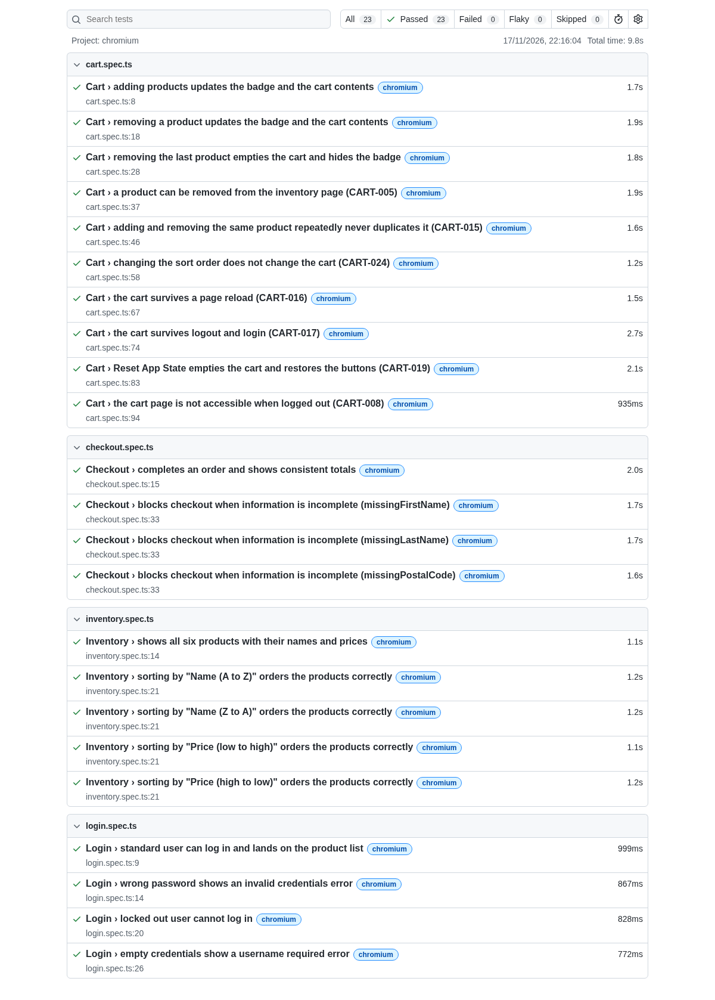

# SmartQA Lab

[](https://github.com/Fabianooliveirasilva/QA-testing-2/actions/workflows/playwright.yml)

A lightweight QA portfolio project that tests the public demo shop [SauceDemo](https://www.saucedemo.com/) with three
complementary approaches: **manual testing documentation**, **AI-assisted QA workflows** and **automated browser tests**
(Playwright + TypeScript). No application was built: SauceDemo is the system under test.

## Manual QA vs AI assistance vs automated execution

| | Manual QA | AI assistance | Automated execution |
|---|-----------|---------------|---------------------|
| Who acts | A QA engineer | A chat assistant (ChatGPT/Claude) | Playwright |
| Strength | Judgement, exploration, deciding what is a defect | Fast drafting of test ideas, bug reports, coverage gaps, failure triage | Fast, repeatable regression of stable flows |
| Output | Executed cases, confirmed bugs | **Hypotheses and drafts only** | Pass/fail evidence, screenshots, traces |
| Authority | Decides | Never decides; a human must approve | Reports facts about what the script checked |

AI output is never treated as a confirmed defect, never invents results, and always separates **evidence** from **hypothesis**.

## Architecture

```
docs/            Test plan, test cases, bug reports, execution report, regression checklist, app analysis
tests/           Playwright specs (login, inventory, cart, checkout) and fixtures
pages/           Page Objects: LoginPage, InventoryPage, CartPage, CheckoutPage
test-data/       JSON data (users, products, checkout) and a typed config reader
ai/prompts/      Five reusable AI prompts
ai/examples/     Worked examples of the prompts on real project data
ai/templates/    Bug report, test case, review checklist and result-input templates
reports/         Generated HTML report, JSON results, failure artifacts (git-ignored)
.github/workflows/  GitHub Actions pipeline
```

Test logic lives in `tests/`, UI interaction in `pages/`, data in `test-data/`, documentation in `docs/`.

## Technologies

Node.js 20 or newer (`.nvmrc` pins 22, used by CI), TypeScript (strict), Playwright Test, GitHub Actions, Markdown, JSON. No Docker, database, backend or dashboard.

## Installation

```bash
git clone https://github.com/Fabianooliveirasilva/QA-testing-2.git && cd QA-testing-2
npm ci
npx playwright install chromium
cp .env.example .env   # optional; defaults work for the public demo
```

## Running the tests

```bash
npm test               # run all tests, generate reports
npm run test:headed    # watch the browser
npm run report         # open the HTML report (reports/html)
npm run typecheck      # TypeScript strict check
npx playwright show-trace <path>/trace.zip   # inspect a failed test
```

Configuration: `BASE_URL` (default `https://www.saucedemo.com`) and `SAUCE_PASSWORD` (the public demo password, read from the
environment so it is not hardcoded in tests). Never commit real credentials.

## Manual testing strategy

- [Test plan](docs/test-plan.md): scope, approach, entry/exit criteria, risks. Severity and priority are rated separately.
- [Test cases](docs/test-cases.md): 11 core cases (login, inventory, sorting, cart, checkout, summary, exploratory) plus 27 shopping-cart cases covering positive, negative, boundary, edge and regression scenarios.
- [Bug reports](docs/bug-reports.md): template and eleven triaged findings with screenshot evidence (including `problem_user`, `error_user` and `visual_user` exploration).
- [Execution report](docs/test-execution-report.md) and [regression checklist](docs/regression-checklist.md).
- [Application analysis](docs/application-analysis.md): workflows, messages and locator strategy found by inspecting the site.

## AI-assisted testing workflows

All prompts work in any chat assistant and need no paid API key. See [ai/prompts/](ai/prompts/README.md).

1. **Test Case Generator** — feature in, structured cases out. The cart cases in `docs/test-cases.md` were produced this way and then verified against the live site.
2. **Bug Report Assistant** — raw notes in, report draft out.
3. **Test Coverage Analyzer** — finds gaps and overlaps.
4. **Regression Test Advisor** — picks regression tests after a change.
5. **Test Result Analyzer** — triages Playwright output (`reports/results.json` or console).

Worked examples with real project data are in [ai/examples/](ai/examples/README.md): bug report drafting, coverage analysis, regression advice and failure triage, each ending with a human review table that says what is confirmed and what is still pending.

Every AI result goes through [the review checklist](ai/templates/ai-output-review-checklist.md) before it enters the repository.

## Automation coverage

23 tests, all independent (each starts from a fresh browser context):

| Area | Scenarios |
|------|-----------|
| Login | successful login, wrong password, locked user, empty credentials |
| Inventory | six products with names and prices, all four sort options |
| Cart | add, remove (cart page and inventory page), remove the last item, no duplicates after repeated add/remove, sorting keeps the cart, survives reload and logout/login, Reset App State, access denied when logged out |
| Checkout | successful order with consistent totals, three incomplete-information cases |

Design choices: accessible locators first (`getByRole`), `data-test` test ids only where no role exists, no fixed sleeps,
Playwright web-first assertions, screenshots on failure, traces retained on failure, HTML and JSON reports.

## CI/CD pipeline

[.github/workflows/playwright.yml](.github/workflows/playwright.yml) runs on push to `main`, pull requests, manual dispatch and a **weekly schedule** (Mondays 06:00 UTC) that detects changes in the public demo site:
install dependencies (`npm ci`), type check, install Chromium, run tests, then upload the HTML report (always) and the failure
artifacts (screenshots and traces, on failure) as workflow artifacts. `SAUCE_PASSWORD` may be set as a repository secret; the public demo default is used otherwise.

## Example results

Local run on 2026-11-17 (Chromium): 23 passed, 0 failed, about 10 seconds, stable across repeated runs. The same suite passes in GitHub Actions.



Open the full report with `npm run report`. Findings from exploratory work, with screenshots, are in [docs/bug-reports.md](docs/bug-reports.md).

## Limitations and future improvements

- SauceDemo has no specification; some expected results are judgement calls and are labelled as such.
- Only Chromium is configured; add Firefox and WebKit projects.
- Exploratory findings (BUG-001 to BUG-011) have screenshot evidence in `docs/evidence/` and were triaged on 2026-11-18; BUG-003 remains `Needs info`.
- Only the standard user is automated; the demo users with known issues (`problem_user`, `error_user`, `visual_user`) are covered by exploratory testing only (see BUG-003 to BUG-009).
- AI workflows are prompt-based by design (no API key); an optional script could automate result triage.
- Add visual and accessibility checks, and Firefox/WebKit projects.

## License

[MIT](LICENSE)
